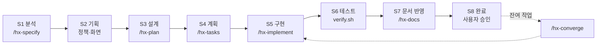

# 03. SDD 워크플로 — SDLC 단계·이슈 폴더·게이트·강제 장치

SDD(Spec-Driven Development)는 스펙을 기준으로 삼고 코드를 그 결과물로 본다. 워크플로 원본은
`.agents/rules/sdd-workflow.md` 한 곳이다. 커맨드 본문은 `.agents/skills/hx-*/SKILL.md`에 있고
스킬이 원본의 해당 절을 읽는다. Claude·Cursor 커맨드와 Kiro 스킬·steering 은 스킬을 가리키는 한 줄 포인터다.

1.0.8부터 SDD 는 SDLC 단계를 따르고, 이슈마다 폴더 하나에 요구·설계·작업·검증을 모은다.
이슈 문서는 변경 기록이고, 기능 문서(`docs/features/`)는 구현된 기능의 현재 모습이다. S7 에서 둘을 맞춘다.

## 1. SDLC 단계와 명령



| 단계 | 산출(이슈) | 산출(기능 문서) | 명령 | 게이트 |
|---|---|---|---|---|
| S1 분석 | requirements — 스토리·`R#.#`·SC | 원고 §요구사항 | `/hx-specify` · `/hx-clarify` | requirements `approved` |
| S2 기획 | requirements §정책(`P-#`)·§화면 | 원고 §정책·§화면 · `_src/mockups` | `/hx-specify` · `/hx-checklist` | 같은 승인 |
| S3 설계 | design — 순서도·시퀀스·상태·DB·인덱스·캐시 키·동시성·API | 원고 §흐름·§시퀀스·§상태 전이 · catalog 배정 | `/hx-plan` · `/hx-analyze` | Constitution Check · design `approved` |
| S4 계획 | `tasks/active.md` | 백로그 추적(생성) | `/hx-tasks` | — |
| S5 구현 | 코드·시험·OpenAPI 스냅숏 | — | `/hx-implement` · `/hx-maintain` | changed 검증 |
| S6 테스트 | tasks `[VERIFICATION]` | 원고 §테스트 | `scripts/verify.sh` | 검증 사다리 레벨 |
| S7 문서 반영 | tasks Polish 체크 | 원고·배정 갱신 → 생성 → 검사 | `/hx-docs` | `feature_docs.py check` 통과 |
| S8 완료 | `check.md` → 사용자 검수 → `completed.md` | 원고 §변경 영향 | — | 사용자 승인 |

- S2 는 S1 과 같은 requirements 에 쓴다. 화면이 없는 이슈는 §화면에 "화면 없음"을 쓴다.
- 기능 문서 생성기가 없는 리포는 S7 을 건너뛰고 이유를 tasks 결과에 적는다.
- `/hx-harness`(규칙 로드)와 `/hx-maintain`(코드 유지보수 기준)은 단계가 아니라 상시 명령이다.

**역할 분담**: `/hx-checklist`는 한 문서(요구사항)의 품질, `/hx-analyze`는 세 문서 사이 정합성을 본다.
둘 다 스펙을 고치지 않는다. `/hx-converge`는 append-only 다 — 기존 Phase·이력을 지우지 않는다.

## 2. 산출 위치 (`.agents/docs/`)

SDD 는 제품(바운디드 컨텍스트) 단위 `<slug>-specs/` 안에서 이슈 폴더로 관리된다.
템플릿은 `_spec-templates/` 한 곳에만 두고 이슈 폴더로 복사하지 않는다(단계에 들어갈 때 그 단계 문서만 렌더한다).

```text
.agents/docs/
├── README.md                     # 기록 시스템 자기서술
├── specs-index.md                # 전 제품 등록표 + SDD 보드(board.sh 가 만든다)
├── _spec-templates/              # 단계 템플릿 원본 한 벌
│   ├── requirements/_template.md #   S1·S2 — 스토리·EARS·SC·정책 표·화면 표·기능 문서 칸
│   ├── design/_template.md       #   S3 — §4.3 순서도 · §4.4 상태 전이 · §7.1 쿼리→인덱스 · §7.2 캐시 · §7.3 동시성
│   ├── checklists/_template.md
│   └── tasks/{_template.md, README.md}   # S4 — Polish 에 문서 반영(/hx-docs) 작업
├── <slug>-specs/                 # ★ new-feature.sh 가 첫 이슈에서 만든다
│   ├── index.md                  #   이 제품의 이슈 등록표
│   └── issues/
│       └── 1-feat-upload-policy/ #   키 = <순번>-<종류>-<이름>
│           ├── requirements.md
│           ├── design.md
│           ├── checklists/<focus>.md
│           └── tasks/
│               ├── active.md     #   상태마다 파일 하나 — 동시에 둘 이상 두지 않는다
│               ├── check.md
│               ├── completed.md
│               └── superseded.md
├── decisions/                    # 전역 ADR + core-beliefs
├── guides/                       # sdd-pattern · harness-engineering · doc-standards · agent-collaboration
├── tech-debt-tracker.md
├── generated/                    # 에이전트 생성물(손편집 금지)
└── references/
```

- 키는 `<순번>-<종류>-<이름>`이다. 종류는 `feat`·`fix`·`refactor`·`perf`·`chore`·`docs`, 이름은 kebab-case.
  순번은 생성 식별자일 뿐이고 우선순위는 requirements 에 따로 적는다. 외부 트래커 번호를 지어내지 않는다.
- 옛 단계별 폴더(`requirements/<key>.md`·`design/<key>.md`·`tasks/<state>/<key>.md`)는 읽고 이어 쓴다.
  자동으로 옮기지 않는다. 새 이슈를 옛 형식으로 만들 때만 `--legacy`를 쓴다.
- 경로는 추측하지 않는다. `check-sdd-prerequisites.sh`가 출력하는 `BASE`·`REQUIREMENTS`·`DESIGN`·`TASKS`를 쓴다.

## 3. 승인과 완료 게이트

- requirements·design 은 상태가 정확히 `approved`일 때만 다음 문서를 만든다. 파일이 있다는 것을 승인으로 보지 않는다.
- 세 문서를 한 번에 만드는 `--all`은 승인 게이트를 건너뛰므로 없다.
- 완료는 `tasks/active.md` → `tasks/check.md` → `tasks/completed.md` 이동과 상태 필드 변경으로 표현한다.
  DoD·verify·S7 검사를 통과하면 check 로 옮기고 사용자 검수를 요청한다. 명시 승인 뒤에만 completed 로 옮긴다.
- 대체된 계획은 `superseded.md`로 두고 후속 이슈와 이유를 적는다.

`check_harness.py --plans-only`(`check-exec-plan-status.sh`가 부른다)가 파일 위치와 상태 필드가 같은지,
check·completed 에 미완료 작업이 없는지 검사한다. "사용자가 승인했는가"는 사람 단계라 스크립트가 강제하지 못한다.

## 4. SDD 스크립트

| 스크립트 | 역할 |
|---|---|
| `new-feature.sh <slug> <name> [--stage=S] [--type=T] [--number=N] [--legacy]` | 이슈 폴더에 **그 단계 문서 하나만** 만든다. 앞 단계가 `approved`가 아니면 거부한다. 제품 폴더가 없으면 골격까지 만들고 `{{PRODUCT_SLUG}}`를 치환한다. 기존 파일을 덮지 않는다 |
| `check-sdd-prerequisites.sh <slug> <key> --stage=design\|tasks\|implement` | 선행 문서와 승인 상태 확인, 실제 경로(`BASE`·`REQUIREMENTS`·`DESIGN`·`TASKS`) 출력 |
| `check-exec-plan-status.sh` | 이슈 tasks 파일 위치↔상태 일관성(새 형식은 엄격, 옛 형식은 상태 토큰) |
| `check-spec-freshness.sh` | 정체된 draft·미해결 `[NEEDS CLARIFICATION:]`·정체된 active tasks 리포트. 게이트가 아니다(항상 exit 0). `/hx-converge` 근거 |
| `board.sh [--check]` | `specs-index.md`의 SDD 보드를 파일 위치로 다시 만든다. `--check`는 어긋나면 실패하고 파일을 쓰지 않는다 |
| `sdd-layout.py scaffold\|prerequisites\|board\|plans\|freshness` | 위 셸 진입점들이 부르는 파이썬 구현(`scripts/harness/sdd_*.py`) |

명령(LLM 프롬프트)과 스크립트(결정론적 셋업)를 나눈다 — 경로·스캐폴딩·상태 검사는 스크립트가, 내용은 에이전트가 쓴다.

## 5. 템플릿 강제 장치

템플릿은 서식이 아니라 에이전트를 제약하는 프롬프트다.

### 5.1 requirements/_template.md (S1·S2)

- **[NEEDS CLARIFICATION] 규약**: 미확정은 추측하지 않고 `[NEEDS CLARIFICATION: 구체 질문]`으로 둔다. 최대 3개, 우선순위 `scope > 보안/프라이버시 > UX > 기술`.
- **우선순위 User Story**: `P1/P2/P3`, 각 스토리는 독립 개발·시험·시연 가능. 추적 ID `US1`…, 수용 기준은 EARS `R1.1`….
- **Success Criteria**: `SC-001`… 측정 가능·기술 중립.
- **정책 표(S2 기획 · 필수)**: `| ID | 규칙 | 강제 위치 |`. 업무 규칙을 조건과 결과로 적고, 강제 위치는 design 에서 정한 뒤 구현하고 나서 실제 클래스·제약 이름으로 고친다. 권한·한도·상태 제약·보존·암호화가 여기 온다.
- **화면 표(화면이 있을 때)**: `| 화면 ID | 경로 | 상태(빈·로딩·오류·권한 없음) | 목업 |`. 화면이 없으면 "화면 없음" 한 줄. 목업은 `docs/features/_src/mockups/<단위>/<경로>.png`.
- **기능 문서 칸**: S7 에서 갱신할 기능 ID(`catalog.json`).

### 5.2 design/_template.md (S3)

- Constitution Check 게이트: guardrails·security·structure·api-standards·reliability 와 영속성 경계(`structure.md`가 정한 스키마·도구·위치) 점검. 불가피한 위반은 Complexity Tracking 에 정당화가 없으면 진행 금지.
- §4.3 순서도 · §4.4 상태 전이(Mermaid) — 기능 문서 §흐름·§상태 전이로 옮겨진다.
- §7.1 쿼리→인덱스(필수) `| 쿼리(어댑터.메서드) | 조건·정렬 칸 | 쓰는 인덱스 | 예상 행 수·근거 |`
- §7.2 캐시(해당 시) `| 캐시 이름 | 키 형식 | TTL·저장소 | 채우는 곳 | 무효화 시점 |` — 없으면 "캐시 없음 — 이유"
- §7.3 동시성 제어(필수) `| 경합 지점 | 방식 | 잠금 키·범위 | 실패·재시도 처리 |` — 방식은 비관적 잠금·낙관적 `@Version`·분산 락·고유 제약·멱등 키 중에서 고른다
- Quickstart(end-to-end 시나리오) · Research & Decisions · 요구사항 추적 매트릭스(`R#.#` → 설계 요소).

### 5.3 checklists/_template.md — CHK-### 5축

| 축 | 번호대 | 검사 |
|---|---|---|
| 완결성 | CHK-001~008 | 우선순위+"왜", 독립 시험 기준, EARS `R#.#`, `SC-###`, NFR, Edge/오류, scope, 제약·가정 |
| 명료성 | CHK-101~105 | 측정 불가 형용사 정량화, 한 수용 기준=한 동작, 대명사 모호성, `[NEEDS CLARIFICATION]≤3`, 구현 세부 누출 금지 |
| 일관성 | CHK-201~205 | 한 용어, 모순 없음, 도메인 규약 일치, 헌법 충돌 없음, 우선순위 일치 |
| 측정가능성 | CHK-301~304 | `SC-###` 숫자·비율·시간, SC 기술 중립, 관찰 가능 결과, 성능 측정 조건 |
| 커버리지 | CHK-401~405 | 스토리 출처, `R#.#`↔SC/검증 수단, 추적 매트릭스, 스토리마다 `[US#]` 작업, 요구 없는 작업 없음 |

### 5.4 tasks/_template.md (S4)

- 작업 포맷 `- [ ] T001 [P] [US1] 설명 + 파일 경로`. `[P]`는 다른 파일·무의존일 때만.
- Phase: Setup → Foundational → User Story 별(P1→P2→P3) → Polish. Polish 에 문서 반영(`/hx-docs`)과 `feature_docs.py check`를 둔다.
- `## 검증 (DoD)` 체크 목록(verify 통과 · 성공+실패 시험 · 401/403 · 품질 점수 · OpenAPI 스냅숏 · 기능 문서 검사 · Quickstart)과 `## 완료 처리`(active → check → 승인 → completed).
- `결과` 절에 실제 실행한 명령과 결과(통과/실패 수)를 적는다. 실행하지 않은 검증을 통과로 적지 않는다.

## 6. 결정·부채 기록

- `decisions/` — 전역 ADR(맥락·결정·근거·대안·결과) + `core-beliefs.md`. 폐기해도 지우지 않고 상태만 바꾼다.
- `tech-debt-tracker.md` — 전역 기술 부채 표. 발견 즉시 등록, 해결 시 링크와 함께 closed, 항목 삭제 금지.
