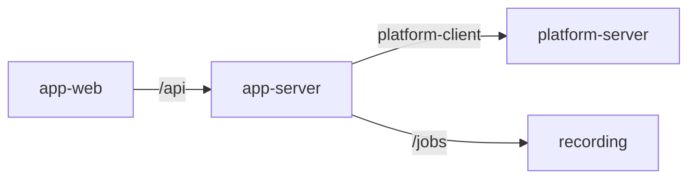

# 문서 기준 — {{PROJECT_NAME}}

이 하네스의 사람용·에이전트용 문서가 지켜야 할 형식이다. 근거는 OpenAI harness engineering · AGENTS.md 표준 · Claude Code 메모리 문서 · Kiro · matklad ARCHITECTURE.md 다.
하네스 검사기(`scripts/check_harness.py`)가 이 기준 가운데 기계로 볼 수 있는 것을 검사한다(§8). 하네스 전체 구조는 [하네스 설명서](harness-engineering.md), SDD 는 [SDD 설명서](sdd-pattern.md).

## 1. 원칙

1. **진입 문서는 목차다.** `AGENTS.md`·`CLAUDE.md`·Kiro steering 은 어디를 읽을지 알려 주는 짧은 문서이고, 상세는 아래 층(ARCHITECTURE · `.agents/rules` · `.agents/roles` · `.agents/docs`)에 둔다.
   에이전트는 연 폴더와 그 상위 폴더의 진입 문서를 이어 붙여 읽는다. 진입 문서에 상세를 넣으면 층마다 같은 비용이 쌓인다.
2. **사실 하나에 원본은 하나다.** 같은 표를 두 문서에 쓰지 않는다. 다른 문서는 원본을 링크한다(§6).
3. **사람용과 에이전트용을 나눈다.** README 는 사람이 "무엇이고 어떻게 시작하나"를 보는 곳이고, AGENTS 는 에이전트가 "무엇을 실행하고 무엇을 하면 안 되고 어디를 더 읽나"를 보는 곳이다.
4. **확인한 것만 쓴다.** 명령·경로·포트·버전은 실행하거나 파일에서 확인한 것만 적는다. 확인하지 못했으면 "(미확인)".
5. **따로 받아도 완결된다.** 이 폴더만 받아도 링크가 끊기지 않는다. 폴더 밖 문서는 GitLab URL 로 적는다. 위 층은 "메인 리포 안이면 …" 한 줄 포인터로만 언급한다.

## 2. README.md — 사람용, 7절

헤딩은 아래 일곱 개를 이 이름 그대로 쓴다(검사기가 본다). 순서도 이대로 둔다.

| 절 | 들어갈 것 | 들어가지 않을 것 |
|---|---|---|
| `## 개요` | 무엇을 하는지 · 누가 쓰는지 · 시스템 안 위치(Mermaid 또는 표 하나) · 상태(Stage) | 구현 상세 |
| `## 구조` | 디렉터리 트리(2~3단계)와 각 폴더의 한 줄 설명 | 파일 하나하나의 설명 |
| `## 준비물` | 도구와 버전 표 · 버전 원본 파일(`build.gradle.kts`·`pyproject.toml`·`package.json`·`.tool-versions` 등) | 설치 튜토리얼 전문 |
| `## 실행` | 따로 받았을 때 · 메인 리포 안일 때(나눠서) · 환경 변수 원본(`.env.example`) | 운영 배포 |
| `## 검증` | `bash scripts/verify.sh --files <paths>`(changed) · `bash scripts/verify.sh --affected`(MR 전) · full은 CI · `HARNESS_VERIFY_LEVEL=fast bash scripts/verify.sh` · 무엇이 도는지 한 줄 · 명령 표의 원본 링크(§6) | 개별 도구 명령을 다시 나열 |
| `## 하네스` | 진입 문서(AGENTS·CLAUDE·Kiro) · 첫 SDD 명령 · 설명서 링크 · 상위 층 포인터 | 규칙 본문 |
| `## 기여` | 브랜치 이름 · 커밋 형식 · 리뷰 기준 링크 · 두 단계 커밋(도메인 리포 → 메인 리포 포인터) · git hook 연결 명령 | git 사용법 일반 |

예 — `## 하네스` 절:

```markdown
## 하네스

에이전트(Claude Code · Codex · Kiro)는 이 폴더의 `AGENTS.md`부터 읽는다. 하네스 구조는 [하네스 설명서](.agents/docs/guides/harness-engineering.md).

| 할 일 | 명령 |
|---|---|
| 기능 시작 | `bash scripts/new-feature.sh <slug> <이름>` |
| 보드 갱신 | `bash scripts/board.sh` |
```

## 3. AGENTS.md — 에이전트용 목차

- **크기**: 150줄 이하. 검사기가 오류로 친다. `CLAUDE.md`는 40줄 이하이고 `@AGENTS.md`와 Claude 전용 차이만 둔다.
- **들어갈 것**(AGENTS.md 표준 권장 절을 우리 층에 맞춤):
  1. 한두 줄 책임과 소유 경계(도메인은 **소유하지 않는 것**까지)
  2. 작업 종류별 시작 위치 표(작업 → 열 폴더 → 먼저 읽을 문서)
  3. 단위 표(도메인·메인)
  4. 먼저 읽을 것(세 개 이하)
  5. 규칙 색인(영역 → 원본)
  6. 명령 표(setup · run · test · verify changed/fast/full, 기대 결과) — 메인·도메인에서는 **검증 명령의 원본**이다.
     단위 AGENTS 는 명령 표 대신 `.agents/rules/tech.md` 「명령」 링크와 verify changed/fast/full 두 줄만 둘 수 있다(§6)
  7. 작업 방식(SDD 위치·완료 게이트)
  8. 이 범위에만 있는 금지 사항
  9. 상위 층 포인터 한 줄
- **들어가지 않을 것**: 규칙 본문, 아키텍처 설명, 파일별 설명.

## 4. ARCHITECTURE.md — 그림 필수

matklad 의 ARCHITECTURE.md 와 C4 를 따른다. 자주 바뀌지 않는 것만 쓰고, 심볼 이름은 적되 코드 링크는 걸지 않는다.

1. **bird's-eye** — 무엇을 푸는지, 범위와 범위 밖
2. **구성도** — Mermaid `flowchart`(검사기는 Mermaid 블록이 하나 이상 있는지 본다)
3. **codemap** — 모듈·폴더 → 책임 → 진입 심볼("X 는 어디 있나"에 답한다)
4. **핵심 흐름** — Mermaid `sequenceDiagram`, 정상과 실패 경로
5. **계약** — API·이벤트·스키마 표(원본 위치·소비자)
6. **불변식** — 불변식 → 이유 → 강제 수단(테스트·린트 이름, 없으면 "수동"). "무엇이 없다"도 불변식이다
7. **교차 관심사** — 인증·테넌시·암호화·로깅·설정·오류 중 해당하는 것
8. **변경 영향** — "이것을 바꾸면 같이 고칠 곳"

예 — 구성도:



## 5. 규칙 파일(`.agents/rules/*.md`)

```markdown
# <주제> — <하네스 이름>

적용 범위: <폴더·파일 패턴>. 목적: <한 줄>.

## 규칙
1. **MUST** <규칙> — 이유: <왜>. 강제: <검사 이름 또는 "수동">.
2. **SHOULD** <규칙> — 이유: <왜>.

## 예
좋은 예 / 나쁜 예(코드 블록)

## 예외
<예외와 승인 절차>

## 관련 문서
```

Kiro steering 포인터(`.kiro/steering/<규칙>.md`)는 front matter(`inclusion`)와 원본 경로, 요약 3~6줄만 둔다.

## 6. 원본 한 곳 — 어떤 사실을 어디에 두는가

| 사실 | 원본 | 나머지 문서 |
|---|---|---|
| 게이트 명령(verify changed·fast·full) | 메인·도메인: `AGENTS.md` 명령 표 / 단위: `AGENTS.md` 「검증」 | README 는 핵심 두 줄과 링크 |
| 개발·실행 명령(run·test·lint) | 단위: `.agents/rules/tech.md` 「명령」 — 단위가 AGENTS 명령 표 하나에 모두 두었으면 그쪽이 원본이고 tech.md 는 링크한다 | README·AGENTS 는 링크 |
| 디렉터리 배치 규칙 | `.agents/rules/structure.md` | README 는 트리만 |
| 단위 사이 계약 | 도메인 `ARCHITECTURE.md` "계약" | 단위 문서는 경로를 글로 적는다 |
| 메인 리포 안에서만 되는 것 | 도메인 `.agents/rules/tech.md` | README·ARCHITECTURE 는 링크 |
| 하네스 동작 | [하네스 설명서](harness-engineering.md) | 진입 문서는 링크 |
| SDD 절차 | `.agents/rules/sdd-workflow.md`(규범) · [SDD 설명서](sdd-pattern.md)(설명·예시) | 진입 문서는 링크 |

## 7. 역할(`.agents/roles/*.md`) — 7절

헤딩은 `## 목적` · `## 쓰는 때` · `## 입력` · `## 절차` · `## 출력` · `## 금지` · `## 완료 조건`(검사기가 본다).
`.claude/agents/<역할>.md`는 front matter 에 `name`·`description`·`tools`를 둔다. Codex(`.codex/agents/*.toml`)와 Kiro(`.kiro/agents/*.json`)도 같은 원본을 가리킨다.

## 8. 검사기가 보는 것

| 검사 | 실패 메시지 |
|---|---|
| README 존재와 7절 | `README.md: missing section '## 기여'` |
| 진입 문서 크기 | `AGENTS.md: 182 lines > 150 — move detail …` |
| ARCHITECTURE 그림 | `ARCHITECTURE.md: no mermaid diagram` |
| 역할 7절 | `.agents/roles/reviewer.md: missing section '## 출력'` |
| Claude 역할 도구 선언 | `.claude/agents/explorer.md: front matter needs tools` |
| 닫히지 않은 코드 펜스 | `AGENTS.md: unclosed code fence at line N` |
| 리포 밖 상대 링크 · 끊긴 링크 | `link escapes harness root` · `broken link` |
| 공통 파일 드리프트 | 메인 리포 `python3 tools/harness/sync.py --check` |

검사기가 볼 수 없는 것(사실 정확성·중복·문체)은 리뷰(`.agents/rules/pr-review-policy.md`)가 본다.
