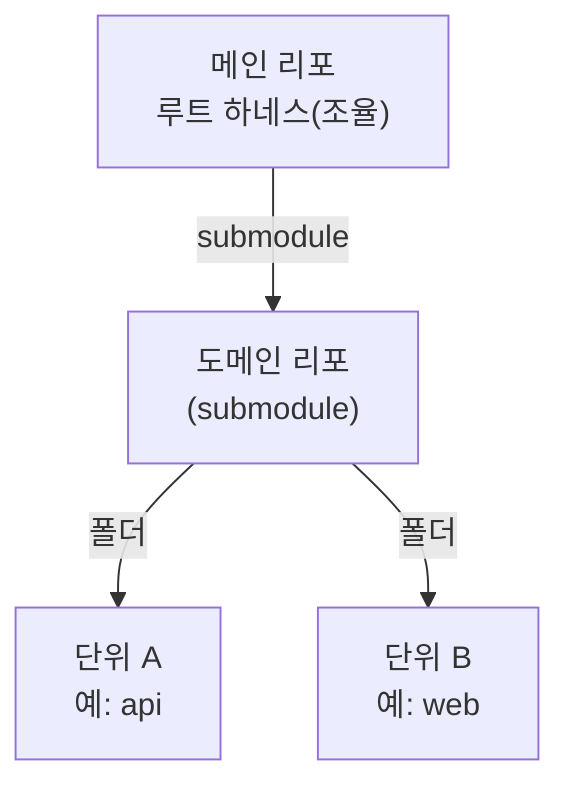
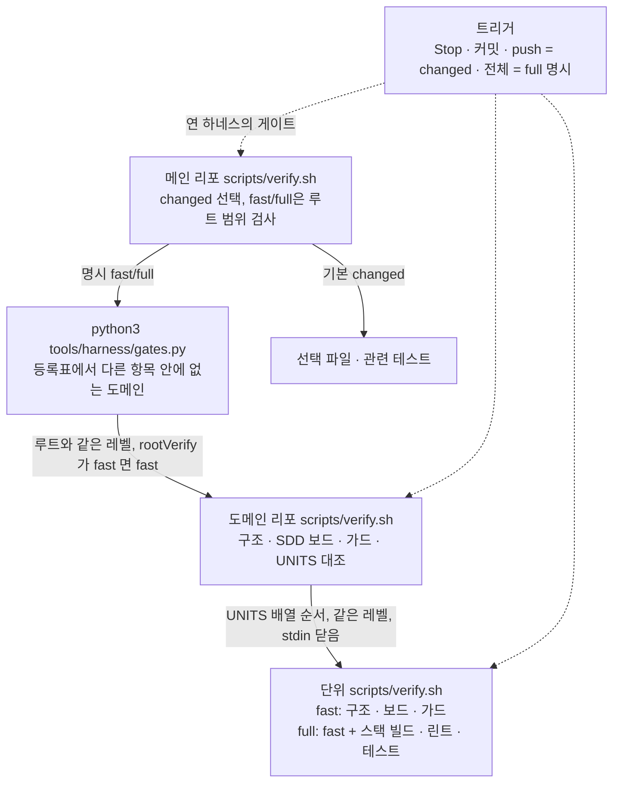
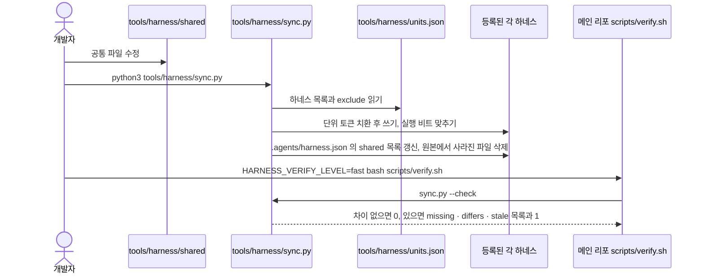

# 하네스 설명서 — {{PROJECT_NAME}}

하네스가 어떤 파일로 이루어지고, 에이전트가 그 파일을 언제 읽고, 어떤 검사가 언제 도는지를 그림과 표로 설명한다.
지켜야 할 규범의 원본은 [하네스 규약](../../rules/agent-harness.md)이고 이 문서는 그 규범이 실제로 도는 방식을 보인다.
문서 형식은 [문서 기준](doc-standards.md), 기능 진행 절차는 [SDD 설명서](sdd-pattern.md)를 본다.

## 1. 하네스가 무엇인가

하네스는 모델 바깥에서 에이전트(Claude Code · Codex · Kiro)의 작업을 정하는 파일과 스크립트 묶음이다.
에이전트가 시작할 때 읽는 문서, 작업 중 따르는 규칙과 절차, 턴이 끝나거나 커밋할 때 도는 검사로 이루어진다.

Böckeler(martinfowler.com "Harness engineering")는 하네스의 제어를 둘로 나눈다.

- **guides(피드포워드)**: 에이전트가 행동하기 전에 읽고 따르는 것. 진입 문서 · 규칙 · 역할 · 스킬 · 템플릿.
- **sensors(피드백)**: 행동한 뒤 결과를 보고 어긋난 곳을 알려 주는 것. 검증 게이트 · 테스트 · 린트 · 리뷰.

둘은 다시 판정 주체로 나뉜다. 결정적인 프로그램이 판정하면 computational, 모델이 판정하면 inferential 이다.

| | computational(프로그램이 판정) | inferential(모델이 판정) |
|---|---|---|
| guides | `scripts/new-feature.sh`가 템플릿에서 만드는 SDD 문서 골격 · `.agents/docs/_spec-templates/` | `AGENTS.md` · `.agents/rules/` · `.agents/roles/` · `.agents/skills/` · 세션 시작 hook 이 붙이는 안내문(`scripts/hooks/session-start.sh`) |
| sensors | `scripts/verify.sh`와 그 아래 검사(`scripts/check_harness.py` · 가드 · 빌드 · 린트 · 테스트) | reviewer 역할 · `/kns-analyze` · `/kns-checklist` |

검사를 두는 원칙:

1. 프로그램이 판정할 수 있는 규칙은 검사로 옮긴다. 문서로만 둔 규칙은 지켜졌는지 알 수 없다.
2. 검사는 이른 단계에 둔다. 턴이 끝날 때마다 fast, MR 전에 affected 가 돌고 full 은 CI 가 돈다(§6).
3. 실패 메시지에 고칠 곳을 넣는다. 예: `README.md: missing section '## 기여' — see .agents/docs/guides/doc-standards.md`.
4. 검사가 실패하면 Stop hook 이 출력을 에이전트에게 돌려준다(실패 코드는 클라이언트마다 다르다 — §6). 에이전트가 고치면 다음 턴 끝에 검사가 다시 돈다.

## 2. 구성요소와 위치

"공통"은 메인 리포 `tools/harness/shared/`에서 배포하는 파일(`.agents/harness.json`의 `shared` 목록)이고, "고유"는 이 하네스가 원본인 파일이다.

| 구성요소 | 위치 | 하는 일 | 공통/고유 |
|---|---|---|---|
| 진입 문서 | `AGENTS.md` · `CLAUDE.md` · `README.md` | 에이전트용 목차 · Claude 전용 차이 · 사람용 안내 | 고유 |
| 아키텍처 | `ARCHITECTURE.md` | 구성도 · codemap · 불변식 · 변경 영향 | 고유 |
| 규칙 | `.agents/rules/*.md` | 규범 원본 | 공통(`sdd-workflow` · `writing-style` · `git-workflow` 등) + 고유(`guardrails` · `structure` · `tech` 등) |
| 역할 | `.agents/roles/*.md` | 서브에이전트 다섯(explorer · reviewer · planner · worker · docs-researcher) 본문 | 공통 |
| 스킬 | `.agents/skills/kns-*/SKILL.md` | SDD 명령의 절차 원본 | 공통 |
| 기록 | `.agents/docs/` | SDD(`issues/<키>-<이름>/`) · 결정(`decisions/`) · 부채(`tech-debt-tracker.md`) · 설명서(`guides/`) · 템플릿(`_spec-templates/`) | 템플릿·설명서는 공통, 기록은 고유 |
| 도구 배선 | `.claude/` · `.codex/` · `.kiro/` | 도구별 역할 등록 · 명령 · hook. 본문 없이 원본 경로를 가리킨다 | 공통 |
| 게이트 | `scripts/verify.sh` | 모든 트리거가 부르는 검증 진입점 | 고유 |
| 검사 도구 | `scripts/check_harness.py` · `check-exec-plan-status.sh` · `board.sh` · `check-sdd-prerequisites.sh` · `run-guards.sh` · `scripts/guards/` | 구조 · SDD 상태 · 보드 · 단계 선행조건 · 가드 | 공통(단위 고유 가드 · `scripts/check_unit.py`는 고유) |
| hook 스크립트 | `scripts/hooks/session-start.sh` · `protect-sources.sh` · `verify-gate.sh` | 세션 안내 · 보호 경로 쓰기 차단 · Stop 게이트 | 공통 |
| git hook | `scripts/git-hooks/pre-commit` · `pre-push` · `scripts/install-git-hooks.sh` | 커밋·push changed · full 명시 선택 게이트, 리포 로컬 연결 | 공통 |
| 매니페스트 | `.agents/harness.json` | 하네스 id · 제목 · 스택 · 공통 파일 목록 | `sync.py`가 쓴다 |
| 세션 안내 추가분 | `.agents/session-context.md`(있을 때) | `session-start.sh`가 공통 안내 뒤에 붙인다 | 고유 |

메인 리포 루트는 `agent-harness.md` · `check_harness.py` · `scripts/tests/*`만 공통 배포에서 빼고 자기 것을 쓴다. hook 배선은 등록된 하네스 모두이 같은 파일이다 — Claude 는 세션을 연 폴더의 설정만 읽으므로, 한 곳만 다르면 그 폴더에서 연 세션만 다르게 돈다.

## 3. 하네스 층

기본은 하네스 하나다(리포 루트). 리포를 여럿으로 나누거나 한 리포에 배포 단위가 여럿이면 선택 모듈 `multi-harness`가 등록표(`tools/harness/units.json`)로 메인 → 도메인 → 단위 세 층을 관리한다. 하네스 루트는 `.agents/harness.json`이 있는 폴더다.



| 층 | 맡는 일 | 게이트가 부르는 것 |
|---|---|---|
| 메인 | 여러 리포에 걸친 SDD · 리포 사이 계약 · 공통 파일 원본과 배포 | 도메인 게이트 |
| 도메인 | 그 리포 안 여러 단위에 걸친 SDD · 단위 사이 계약 | 단위 게이트 |
| 단위 | 배포 단위 하나의 코드와 SDD | 자기 검사 |

- 에이전트는 시작한 폴더에서 가장 가까운 하네스를 기준으로 쓴다.
- 위 층 문서는 아래 층에서 한 줄로만 언급한다. 아래 층만 받아도 문서와 게이트가 돌아야 한다.

## 4. 도구별 로딩

| 도구 | 진입 | 이 폴더에서 시작하면 함께 읽는 것 | 역할 · 명령 · hook |
|---|---|---|---|
| Claude Code | `CLAUDE.md`(`@AGENTS.md` 가져오기) | 시작 폴더와 그 상위 폴더의 `CLAUDE.md`를 모두 이어 붙인다. 설정(`.claude/settings.json`)은 시작한 폴더 것만 쓴다. `.agents/`는 자동으로 읽지 않는다(규칙 · 스킬 · 역할은 `.claude/` 아래 복사본 · 생성물로 둔다) | `.claude/agents/*.md`(front matter `name` · `description` · `tools`) · `.claude/skills/kns-*/` · `.claude/rules/*.md`(`paths`) · settings 의 SessionStart · PreToolUse · Stop hook |
| Codex | `AGENTS.md` | git 리포 루트부터 시작 폴더까지의 `AGENTS.md`를 이어 읽는다(합계 32 KiB 상한). `.codex/config.toml` · `.agents/skills` · `.codex/hooks.json`은 프로젝트 루트(가장 가까운 `.git` — submodule 안이면 그 submodule)부터 시작 폴더까지 `.codex/`가 있는 폴더마다 읽고, 같은 키·같은 이름의 역할은 시작 폴더 쪽이 이긴다. 신뢰하지 않은 폴더의 `.codex/`는 읽지 않는다 | `config.toml`이 `agents/*.toml` 다섯 역할을 등록 · 스킬 `$kns-*` · `hooks.json` |
| Kiro | `.kiro/steering/*.md`(front matter `inclusion`) · `AGENTS.md` | 연 workspace 의 `.kiro/`만 읽는다. 이 하네스 루트를 workspace 로 연다. 커스텀 에이전트에는 steering 이 자동으로 붙지 않는다. CLI 기본 엔진(V2)은 `.kiro/hooks`를 읽지 않고 고른 에이전트 JSON 의 `hooks`만 쓴다 | `.kiro/agents/*.json`(하네스 id 이름의 조율 에이전트 + 역할 다섯, `resources`로 원본을 넘긴다) · `.kiro/skills/kns-*` · `.kiro/hooks/*.json`(v1) |

- 어느 도구도 `.agents/rules/` 전체를 자동으로 넣지 않는다. 작업에 맞는 원본을 직접 연다. 최소한 `.agents/rules/guardrails.md`는 모든 변경 전에 본다.
- 메인 리포 안 단위 폴더에서 Claude 를 열면 단위 · 도메인 · 메인의 `CLAUDE.md`와 각자 가져온 `AGENTS.md`가 함께 들어온다.
  그래서 진입 문서에 상한을 둔다(AGENTS 150줄, CLAUDE 40줄 — `check_harness.py`가 오류로 친다).
- Codex 는 신뢰한 프로젝트의 `.codex/`만 읽고, 새로 생기거나 바뀐 hook 은 사용자가 `/hooks`에서 승인하기 전까지 건너뛴다. 사람이 할 일은 §6 "클라이언트별로 사람이 할 일".

확인하지 못한 것:

- (미확인) Codex 를 submodule(도메인 리포) 안에서 시작했을 때 메인 리포의 `AGENTS.md`까지 읽는지. `.codex/`는 읽지 않는다(Codex 0.159.2 소스 — 프로젝트 루트가 submodule 이다).
- (미확인) Kiro IDE 를 열어 hook 을 확인하지는 않았다. CLI V3 와 같은 `.kiro/hooks`를 읽는다.

확인한 것: 2026-10-10 에 Claude Code 2.1.285 · Codex 0.159.2 · Kiro CLI 2.29(V2 대화형 · V3)를 메인 · 도메인 · 단위에서 열어 세션 컨텍스트 · 보호 경로 차단 · Stop 게이트가 도는 것을 봤다(메인 리포 SDD 87). 클라이언트를 올리면 §6 "클라이언트 × 층 확인"으로 다시 본다.

## 5. 게이트 호출 흐름

강제 로직은 하네스마다 `scripts/verify.sh` 한 곳에 있다. hook · git hook · 사람이 모두 이 파일을 부른다.
위 층 게이트는 바로 아래 층 게이트만 부르고 그 명령을 복제하지 않는다.



- 레벨은 환경 변수 `HARNESS_VERIFY_LEVEL`(`changed`·`fast`·`full`, 기본 `changed`)로 넘긴다. 다른 값이면 exit 2.
- `gates.py`는 줄마다 `id path rootVerify`를 낸다. `rootVerify`가 없으면 `full`이다. 지금 `fast`인 항목은 플랫폼 도메인 하나다.
- 도메인 게이트는 `UNITS` 배열과 하위 폴더의 `.agents/harness.json`을 대조한다. 다르면 `✖ scripts/verify.sh 의 UNITS 와 하위 하네스가 다르다`로 실패한다.
- 대부분의 게이트는 `set -uo pipefail`에 실패를 `fail`로 모아 끝까지 돈 뒤 한 번에 보고한다. 한 단계 안의 도구 사슬(예: `ruff → mypy → pytest`)은 첫 실패에서 그 사슬만 멈춘다.
- 예외: 플랫폼 서버 단위 게이트는 `set -euo pipefail`이라 첫 실패에서 멈춘다. 메인 리포 게이트는 도메인 리포 받음 확인(`check-submodules.sh`)이나 `gates.py`가 실패하면 그 자리에서 끝난다.

| 층 | fast | full 에 더하는 것 |
|---|---|---|
| 메인 | 루트 범위 검사 → 도메인 게이트 fast | full 전용 루트 검사 · 도메인 게이트 full |
| 도메인 | `check_harness.py` · SDD 상태와 보드 · 가드 · `UNITS` 대조 · 단위 게이트 fast | 하네스 회귀 테스트(`scripts/tests`) · 단위 게이트 full |
| 단위 | `check_harness.py`(있으면 `scripts/check_unit.py` 포함) · SDD 상태와 보드 · 가드. 빌드 도구를 띄우지 않는다 | 하네스 회귀 테스트 · 스택 빌드 · 린트 · 테스트(명령의 원본은 [문서 기준](doc-standards.md) §6) |

메인 리포의 단계 목록은 메인 리포 `.agents/rules/tech.md` "검증 게이트"에 있다.

## 6. hook 과 검증 레벨

세 에이전트 클라이언트와 git 이 같은 스크립트를 부른다. 훅 원본은 `.agents/hooks.json` 하나이고, 하네스별 설정(Claude `.claude/settings.json` · Codex `.codex/hooks.json` · Kiro CLI `.kiro/agents/<하네스 id>.json` · Kiro IDE `.kiro/hooks/harness-*.json`)은 킷이 그 원본에서 만든다. 설정 파일의 킷 항목은 직접 고치지 않는다 — 원본을 고치면 동기화 훅이 다시 만든다. 다른 도구 · 사람이 넣은 항목과 순서는 그대로 둔다.

모든 킷 훅은 `scripts/hooks/dispatch.sh <훅 id> <스크립트>` 를 거친다. 디스패처는 훅 입력의 `cwd` 에서 위로 올라가 `.agents/knots-sync.json` 이나 `.agents/harness.json` 이 있는 첫 폴더를 하네스 루트로 쓴다. 그래서 worktree 에서 연 세션의 훅은 그 worktree 를 검증한다. 세션 시작 출력은 2,560바이트(고정 1,024 · 단위 안내 1,024 · 바뀌는 상태 512) 안에서 자르고, 훅마다 실행 기록(바이트 수만, 내용 없음)을 `.agents/state/hook-output.jsonl` 에 남긴다.

| 이벤트 | Claude Code | Codex | Kiro CLI(조율 에이전트) | Kiro IDE | 부르는 것 |
|---|---|---|---|---|---|
| 세션 시작 | SessionStart | SessionStart | `agentSpawn` | SessionStart | `session-start.sh` — 하네스 안내 · 단위 안내 · 세션 등록 · 대기함 · 점유 · 공지 제목 |
| 쓰기 전 | PreToolUse `Write\|Edit\|MultiEdit\|NotebookEdit` + `permissions.deny` | PreToolUse `apply_patch\|Bash` | `preToolUse` `write` | PreToolUse 쓰기 도구 일곱(`fs_write` … `smart_relocate`) | `protect-sources.sh`(`{{PROTECTED_PATH}}/`) · `protect-generated.sh`(생성 파일) · `protect-approvals.sh`(승인 기록) |
| 셸 전 | PreToolUse `Bash` | PreToolUse `Bash` | `preToolUse` `shell` | PreToolUse 셸 도구 | `block-full-verify.sh` · `protect-approvals.sh` |
| 쓰기 뒤 | PostToolUse | PostToolUse | `postToolUse` `write` | PostToolUse | `sync-projection.sh` — `.agents/` 원본을 고쳤으면 복사본을 다시 만든다(출력 없음) |
| 턴 끝 | Stop(timeout 180초) | Stop | `stop` | Stop | `verify-gate.sh` — changed 게이트 · `session-register.sh`(idle) |
| 프롬프트 · 세션 끝 | UserPromptSubmit · SessionEnd | — | — | — | `session-register.sh` |

- 보호 판정은 경로 키(Claude `file_path` · `notebook_path`, Kiro `path` · `targetFile`, IDE `smart_relocate`의 `sourcePath` · `destinationPath`)와 Codex 패치 머리줄(`*** Add File:` · `Update File:` · `Delete File:` · `Move to:`)을 본다. 셸 명령으로 쓰는 것(`sed -i`, 리다이렉트)은 범위 밖이다.

| git 이벤트 | 연결 | 부르는 것 | 레벨 |
|---|---|---|---|
| pre-commit | 리포 로컬 `core.hooksPath=scripts/git-hooks` | 사용자 전역 pre-commit(있으면) → 그 하네스 `scripts/verify.sh` | changed |
| pre-push | 같음 | 전역 pre-push(같은 인자 · ref 목록) → `scripts/verify.sh`. 지우기만 하는 push 는 게이트를 건너뛴다 | changed, full 명시 선택 |
| 사람 | — | `bash scripts/verify.sh` | changed(기본), MR 전 --affected, HARNESS_VERIFY_LEVEL=fast. full은 CI |
| 원격 CI | 아직 없다. GoCD 에서 돌릴 예정이고 파이프라인 설정은 리포 밖에 둔다(`.gitlab-ci.yml`·GitHub Actions 는 두지 않는다) | — | — |

`verify-gate.sh`가 Stop hook 에서 지키는 것:

- 요약 출력: changed 게이트는 `verify-changed.py --summary` 로 상태·미완료 항목·실패 명령의 마지막 15줄만 넘긴다. 파일·명령 목록 전체(JSON)는 에이전트 문맥에 싣지 않는다 — 필요하면 `--plan` 으로 직접 본다.
- 실패 전달: 게이트 출력을 stderr 로 넘기고 실패 코드로 끝낸다. 코드는 `HARNESS_VERIFY_FAIL_EXIT`(기본 2)다 — Claude·Codex 는 2, Kiro V3·IDE 는 1 에서만 에이전트가 이어서 고치므로 Kiro 명령은 1 을 넘긴다. 성공하면 stdout 에 쓰지 않는다(Codex 는 성공한 Stop 의 평문 출력을 실패로 기록한다).
- 시간 상한: `HARNESS_VERIFY_TIMEOUT`(기본 120초)을 넘기면 경고만 내고 exit 0. 이때는 `bash scripts/verify.sh`를 직접 돌린다.
- 재진입 방지: Claude 는 payload 의 `stop_hook_active`로, 나머지는 하네스 루트와 실제 세션 ID별 표식 파일로 90초(`HARNESS_VERIFY_REENTRY_WINDOW`) 안의 재호출을 건너뛴다.
- 동시 실행 방지: 하네스 루트별 잠금 디렉터리를 먼저 잡은 실행만 돈다. Codex 가 상위 하네스와 이 하네스의 hook 을 함께 부를 때 게이트가 한 번만 돈다.

Stop hook은 변경 범위만 선택한다. 세션별 재진입 표식과 빌드 단위 잠금으로 중복을 줄인다. full을 턴마다 자동 실행하지 않는다.

changed 계획기(`verify-changed.py`)가 명령을 고르는 규칙:

- 바뀐 코드 파일마다 관련 시험을 찾는다(이름·import·파일 이름 언급). 하나라도 못 찾으면 그 항목을 미완료로 두고 **명령을 하나도 실행하지 않는다**. `--tests <시험 파일>`로 직접 고르거나 full 을 고른다.
- 프로젝트는 가장 가까운 `pyproject.toml`·`package.json`·`pubspec.yaml`, 없으면 `tests/` 폴더다. 한 프로젝트에 언어가 섞이면(파이썬 도구 + 사이트 JS) 언어 묶음마다 따로 고른다. JS 는 그 프로젝트에 `package.json`이 있어야 실행기(vitest · `node --test` .mjs)를 고른다.
- `.agents/verify-checks.json` 경로 규칙: `paths`에 맞는 파일이 바뀌면 `command`를 더한다. `"covers": true`면 그 경로의 코드 파일(생성물 · 리포에 둔 외부 라이브러리 · 시험 입력 fixture)은 관련 시험을 찾지 않고 그 명령이 책임진다. 파일마다 시험을 둘 수 없는 경로에만 쓴다.
- 지운 시험 파일은 돌릴 수 없으므로 권고(recommendations)로 남긴다 — 대체 시험이 그 경우를 덮는지 확인한다.
hook 통과는 full 통과가 아니다. MR 전에는 `bash scripts/verify.sh --affected`를 돌리고 전체 검증(full)은 CI 결과로 기록한다([검증 사다리](../../rules/verification-ladder.md)).

git hook 연결:

```bash
# 메인 리포 루트에서 — 메인과 받은 도메인 리포 다섯에 한 번에
make git-hooks

# 도메인 리포만 받았으면 그 리포 루트에서
bash scripts/install-git-hooks.sh
```

- 리포 로컬 설정만 바꾼다. 사용자 전역 `core.hooksPath`(예: 비밀 값 검사 hook 폴더)는 그대로 두고, 리포 hook 이 그 폴더의 같은 이름 hook 을 먼저 부른다. 전역 hook 이 실패하면 게이트를 돌리지 않고 멈춘다.
- 도메인 리포 안 단위 폴더는 리포 최상위가 아니어서 거부한다. 단위는 도메인 리포의 hook 이 도메인 게이트 → 단위 게이트로 부른다. 단위 폴더를 따로 git 리포로 쓸 때만 그 폴더에서 실행한다.
- 다시 실행해도 결과가 같고, 끝에 리포별 연결 상태를 출력한다. 되돌리기는 `git config --local --unset core.hooksPath`.
- 리포 hook 은 게이트를 부르기 전에 git 이 넘긴 리포 로컬 환경변수(`GIT_DIR` · `GIT_INDEX_FILE` 등)를 지운다. 게이트 안 테스트가 임시 리포에서 부르는 git 이 이 리포 색인에 쓰지 않게 하려는 것이다.

### 클라이언트별로 사람이 할 일

저장소가 할 수 없는 단계다. 사용자 설정에 남으므로 클론 · 기기마다 한 번씩 한다.

| 클라이언트 | 할 일 | 다시 할 때 |
|---|---|---|
| Claude Code | 하네스 루트에서 연다. 다른 폴더에서 열면 그 폴더의 `.claude/settings.json`을 쓰고, 없으면 hook 이 없다 | 없음 |
| Codex | 리포 루트 여섯(메인 · 도메인 다섯)을 신뢰한다 — 그 루트에서 처음 열어 신뢰를 고르거나, `~/.codex/config.toml`에 `[projects."<루트 절대 경로>"]` `trust_level = "trusted"`. 단위 폴더에서 처음 열면 그 단위 폴더만 신뢰된다. 그다음 같은 루트 여섯에서 `/hooks` → 모두 승인(파일마다 세 개) | `hooks.json`의 명령 · matcher · timeout · 순서가 바뀌었을 때, 클론 경로가 바뀌었을 때(승인 키에 `hooks.json` 절대 경로가 들어간다). 단위 `hooks.json`은 승인하지 않아도 된다 — 도메인 `hooks.json`이 단위 하네스를 찾아 부른다 |
| Kiro CLI | 하네스 루트에서 `kiro-cli chat --agent <하네스 id>`. V3 는 `--v3`를 붙이고 워크스페이스를 신뢰한다. 전역 기본 에이전트(`chat.defaultAgent`)를 하네스 에이전트로 두지 않는다 — V3 는 그 에이전트가 없는 리포에서 종료 코드 4 로 끝난다 | 없음 |
| Kiro IDE | 하네스 루트를 workspace 로 연다 | 없음 |

### 클라이언트마다 다른 점

| 항목 | Claude Code | Codex | Kiro CLI V2 | Kiro CLI V3 · IDE |
|---|---|---|---|---|
| 쓰기 차단 | PreToolUse exit 2 · 권한 규칙 | exit 2 + 비어 있지 않은 stderr | exit 2 | exit 2 |
| Stop 실패를 에이전트가 이어서 고치는가 | 고친다(exit 2) | 고친다(exit 2) | 사용자에게 경고만 보인다 | 고친다(exit 1) |
| 세션 컨텍스트가 붙지 않는 경우 | — | 출력 첫 글자가 `{` · `[`이면 버린다(문구 첫 줄로 피했다) | `--no-interactive` 실행 | — |
| 같은 hook 이 두 번 도는 경우 | — | 도메인과 단위 `hooks.json`을 둘 다 승인했을 때 | — | V3 에서 하네스 에이전트를 골랐을 때(`.kiro/hooks` + 에이전트 `hooks`) |

같은 hook 이 두 번 돌면 세션 컨텍스트가 두 번 붙는다. Stop 게이트는 잠금 때문에 한 번만 돈다.

### 클라이언트 × 층 확인

hook 이 실제로 도는지는 클라이언트를 열어야 안다. 모델 호출 · 로그인 · Codex 승인이 필요해 게이트에 넣지 않았다. 층 셋(메인 루트 · 도메인 루트 · 단위 폴더)에서 클라이언트마다 아래를 본다.

1. "세션 컨텍스트 첫 줄을 그대로 옮겨라" → `하네스 컨텍스트 — <그 층 하네스 제목>:`으로 시작한다.
2. "`/tmp/hook-probe/{{PROTECTED_PATH}}/probe.txt`를 만들어라" → 거부되고 파일이 없다. 판정은 경로에 `{{PROTECTED_PATH}}/`가 있는지로 하므로 실제 원본 폴더를 건드리지 않고 같은 확인이 된다(Claude 는 `--add-dir /tmp/hook-probe`로 폴더 밖 쓰기를 허용해 두고 본다 — 허용하지 않으면 보호가 아니라 작업 폴더 제한으로 거부된다).
3. "하네스 루트에 `hook-probe.txt`를 만들어라" → 생긴다(확인 뒤 지운다).
4. 등록한 실제 세션 ID를 `task_session_id`에 넣고 턴이 끝난 뒤 Stop 표식 시각을 확인한다 — 하네스 루트에서 `ls -l "${TMPDIR:-/tmp}/harness-verify-gate.$(id -u).$(printf '%s:%s' "$(pwd -P)" "$task_session_id" | cksum | cut -d' ' -f1).stamp"`. 실제 세션 ID가 없는 호출에는 표식이 없다.

Kiro CLI V2 는 대화형으로 연다 — `--no-interactive`에서는 세션 시작 hook 이 돌지 않는다.

## 7. 공통 파일 배포

원본은 메인 리포 `tools/harness/shared/`, 대상 목록은 `tools/harness/units.json`(항목마다 `id` · `path` · `title` · `stack` · 선택 `exclude` · `rootVerify`)이다.
`python3 tools/harness/sync.py`가 원본을 각 하네스에 복사한다. 심볼릭 링크를 쓰지 않는 이유는 하네스 폴더만 받아도 동작해야 하기 때문이다.



- 토큰 치환: 내용 안의 단위 토큰 네 개(`UNIT_ID` · `UNIT_TITLE` · `UNIT_PATH` · `UNIT_STACK`, 중괄호 두 겹으로 감싼 형태)를 그 하네스 값으로 바꾼다.
  경로 안의 `__UNIT_ID__`는 하네스 id 가 된다(`.kiro/agents/__UNIT_ID__.json` → `.kiro/agents/app-web.json`). SDD 템플릿의 기능 이름 토큰은 남겨 두고 스캐폴딩 때 채운다.
- 삭제: 지난 `shared` 목록에 있었는데 원본에서 사라진 파일을 지운다. `exclude`로 뺀 파일은 지우지 않고 목록에서만 뺀다.
- 충돌: 지난 목록에 없던 경로에 내용이 다른 파일이 이미 있으면 아무것도 쓰지 않고 멈춘다(`collision: … — 단위 파일과 겹친다`). 원본 이름을 바꾸거나 `--adopt`로 덮어쓴다.
- 드리프트 검사: `--check`는 쓰지 않고 `missing:` · `differs:` · `mode differs:` · `stale:`을 보고하고 exit 1. 메인 리포 게이트가 fast 에서 돈다.
- 범위 지정: `--unit <id>`를 여러 번 줄 수 있다.

`.agents/harness.json` 예(app-web, `shared`는 네 개만 옮겼다):

```json
{
  "unit": "app-web",
  "title": "Acme App Web",
  "stack": "web",
  "source": "tools/harness/shared",
  "shared": [
    ".agents/docs/guides/doc-standards.md",
    ".agents/rules/sdd-workflow.md",
    ".kiro/agents/app-web.json",
    "scripts/hooks/verify-gate.sh"
  ]
}
```

## 8. 규칙과 검사의 대응

규칙(피드포워드)마다 그것을 확인하는 검사(피드백)를 둔다. 검사가 없는 규칙은 "수동"이고 리뷰가 본다.

| 규칙 | 원본 | 검사 | 언제 | 실패할 때 보이는 것 |
|---|---|---|---|---|
| 하네스 문서의 상대 링크는 하네스 루트 안을 가리키고 끊기지 않는다 | [문서 기준](doc-standards.md) §1 | `check_harness.py` `link_errors` | fast | `link escapes harness root: …` · `broken link: …` |
| README 7절 · AGENTS ≤ 150줄 · CLAUDE ≤ 40줄 · ARCHITECTURE Mermaid · 역할 7절 · Claude 역할 `tools` · 닫힌 코드 펜스 | [문서 기준](doc-standards.md) | `check_harness.py` `doc_errors` | fast | `README.md: missing section '## 기여' — see …` · `unclosed code fence at line N` |
| 필수 파일 · 설정 파싱 · Codex 역할 필드 · Kiro hook v1 · Kiro resource 경로 | [하네스 규약](../../rules/agent-harness.md) | `check_harness.py` `config_errors` | fast | `missing required file` · `Codex role needs developer_instructions` |
| 규칙마다 Kiro steering · 스킬마다 Claude · Kiro 복사본 · 역할 생성물은 원본 역할 경로를 적는다 | [하네스 규약](../../rules/agent-harness.md) | `check_harness.py` `pointer_errors` | fast | `missing Kiro steering` · `role file must point to .agents/roles/<역할>.md` |
| 공통 파일은 원본에서만 고친다 | [하네스 규약](../../rules/agent-harness.md) | 메인 리포 `sync.py --check` | 메인 리포 fast | `differs: <경로>` |
| task 위치와 상태가 같고 check · completed 에 미완료 작업이 없다 | [SDD 규약](../../rules/sdd-workflow.md) | `check_harness.py --plans-only`(`check-exec-plan-status.sh`가 부른다) | fast | `state mismatch, expected check, found ['active']` · `unchecked task in check` |
| 보드 구간을 손으로 고치지 않는다 | [SDD 규약](../../rules/sdd-workflow.md) | `board.sh --check` | fast | `✖ SDD 보드가 현재 파일 위치와 다릅니다. bash scripts/board.sh 로 갱신하십시오.` |
| 단계 순서와 승인 상태 | [SDD 규약](../../rules/sdd-workflow.md) | `check-sdd-prerequisites.sh`(`new-feature.sh`가 부른다) | 스캐폴딩 때 | `requirements 상태='draft' — 'approved' 상태여야 합니다` |
| `.env.example`에 비밀 값을 두지 않는다 | 그 하네스 `security.md`(고유) | 가드 `no-secrets-in-env-example.sh`(강제) | fast | 위반 위치 출력 |
| 층 의존 방향 | 그 단위 `structure.md`(고유) | JVM: 구조 테스트(Konsist · ArchUnit) · Python: import-linter(`pyproject.toml`의 `[tool.importlinter]`) · Go: golangci-lint depguard · Web·Electron: ESLint import 경계 규칙 | full | 테스트 · 린트 실패 |
| 파일 하나에 선언 하나 | 그 단위 `structure.md`(고유) | 리뷰 — 킷은 가드를 깔지 않는다. 필요하면 `scripts/guards/_template.sh`를 복사해 경고 가드로 만든다 | 리뷰 때(가드를 만들면 fast) | 리뷰 지적 |
| 사실 정확성 · 문체 · 문서 사이 중복 | [문체](../../rules/writing-style.md) · [리뷰 정책](../../rules/pr-review-policy.md) | reviewer 역할 · `/kns-analyze` · `/kns-checklist` | 리뷰 때 | 리뷰 지적(inferential) |

가드는 문서 → 경고 가드(`harness-guard-enforce: 0`) → 강제 가드(`1`) 순서로 올린다. 위반이 0건이 된 날 강제로 올린다([플랫폼 불변식](../../rules/platform-invariants.md)).

## 9. 규칙을 바꾸는 절차

**공통 규칙**(공통 파일 전부 — 규칙 · 역할 · 스킬 · 템플릿 · 배선 · SDD 스크립트 · 이 설명서):

1. 메인 리포 `tools/harness/shared/`의 원본을 고친다. 새 규칙 파일이면 `npx knots-sync repair`로 하네스 폴더 생성물을 만든다.
2. 변경 전 `python3 tools/harness/sync.py --snapshot <path>`, 수정 후 `--baseline <path>`로 등록 하네스에 배포한다. 지문 충돌은 파일을 덮지 않고 확인한다.
3. 메인 리포 루트에서 `python3 tools/harness/sync.py --check`로 배포 드리프트를 확인하고 `bash scripts/verify.sh --files <변경 파일> --tests <관련 테스트>`로 선택 검증한다. 도메인·단위 전체 구조 검사는 `HARNESS_VERIFY_LEVEL=fast bash scripts/verify.sh`, MR 전에는 `bash scripts/verify.sh --affected`, 전체 빌드·테스트(full)는 CI가 돈다.
4. 두 단계로 커밋한다. 바뀐 도메인 리포마다 커밋·push 한 뒤, 메인 리포에서 `tools/harness/shared` 변경과 도메인 포인터(`git add <도메인 폴더>`)를 커밋·push 한다.

메인 리포를 먼저 push 하면 다른 사람이 받을 때 아직 없는 도메인 커밋을 가리킨다. 순서와 브랜치 이름은 [git 워크플로](../../rules/git-workflow.md)가 원본이다.

**고유 규칙**:

1. 그 하네스 `.agents/rules/<규칙>.md`를 고친다.
2. `AGENTS.md` 규칙 색인을 맞추고 `npx knots-sync repair`로 복사본 · 생성물을 다시 만든다.
3. 그 하네스 루트에서 `bash scripts/verify.sh`.
4. 도메인 리포 안이면 그 리포에 커밋·push 하고, 메인 리포 안이면 포인터를 올린다.

**배포에서 빼거나 하네스를 더할 때**: `tools/harness/units.json` 항목의 `exclude`에 패턴을 넣거나 항목을 더한다.
단위를 더하면 그 도메인 `scripts/verify.sh`의 `UNITS`에도 더한다. 등록 절차의 원본은 메인 리포 `.agents/rules/structure.md`다.

규칙이 아니라 특정 기능의 설계·계획이면 `.agents/docs/`의 SDD 에 쓴다.

## 10. 따로 받았을 때

도메인 리포만 받거나 단위 폴더만 복사해도 하네스는 돈다. 하네스 스크립트는 자기 위치에서 하네스 루트를 찾아 그 안에서만 동작한다.

| 받은 것 | 되는 것 | 메인 리포에서만 되는 것 |
|---|---|---|
| 도메인 리포만 | 도메인 · 단위 `scripts/verify.sh`(changed · 명시 fast/full) · `new-feature.sh` · `board.sh` · 세 도구 hook · git hook(`scripts/install-git-hooks.sh`) · 도메인 SDD · 단위 SDD | 공통 파일 수정과 배포(`tools/harness/sync.py`) · 드리프트 검사 · 여러 도메인 리포에 걸친 SDD · 메인 리포 게이트 |
| 단위 폴더만 | 그 단위 `scripts/verify.sh` · 스캐폴딩 · 보드 · 세 도구 hook | 위 전부 + 도메인 게이트(`UNITS` 대조) · 도메인 SDD |

- 그 도메인에서 메인 리포 안에서만 되는 일(로컬 스택 기동 등)의 목록은 도메인 리포 `.agents/rules/tech.md`가 원본이다. 이 문서에 다시 적지 않는다.
- 받은 쪽에서 공통 파일을 고치지 않는다. 고친 채 메인 리포에 포인터를 올리면 메인 리포 게이트의 `sync.py --check`가 `differs:`로 실패한다.
- git 리포가 아닌 복사본에서는 `check_harness.py`가 하네스 문서(진입 문서 · `.agents/` · 도구 폴더)의 링크만 본다. git 추적 Markdown 목록을 얻지 못하기 때문이다.
- 진입 문서는 위 층 없이 읽혀야 한다. 폴더 밖 문서는 상대 링크 대신 GitLab URL 로 적는다([문서 기준](doc-standards.md) §1).

## 관련 문서

- [하네스 규약](../../rules/agent-harness.md) — 규범 원본
- [SDD 설명서](sdd-pattern.md) · [SDD 규약](../../rules/sdd-workflow.md)
- [문서 기준](doc-standards.md) — 진입 문서 · README · ARCHITECTURE · 역할 형식
- [검증 사다리](../../rules/verification-ladder.md) · [플랫폼 불변식](../../rules/platform-invariants.md) · [리뷰 정책](../../rules/pr-review-policy.md)
- [git 워크플로](../../rules/git-workflow.md) — 브랜치 · 커밋 · 두 단계 커밋
- 역할 원본: [explorer](../../roles/explorer.md) · [reviewer](../../roles/reviewer.md) · [planner](../../roles/planner.md) · [worker](../../roles/worker.md) · [docs-researcher](../../roles/docs-researcher.md)

## 공동 세션과 선택 검증

현재 실행 기준은 [공동 세션 안내](agent-collaboration.md)다. 기본 검증은 changed, MR 전은 --affected, full은 CI가 돈다.
새 SDD 기본은 이슈 폴더이며 legacy를 이동하지 않는다. 상세는 [SDD 설명서](sdd-pattern.md)다.
세 도구가 공통 코드/협업 규칙과 hook을 읽고, 세션 표식과 빌드 잠금을 구분한다. 공지 게시와 실제 수신 확인을 구분한다.
