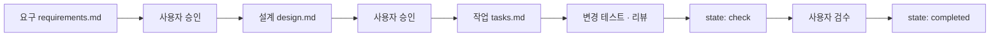
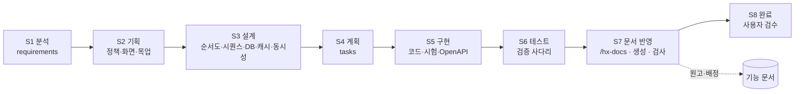

# SDD 설명서 — 이슈 한 폴더

규범은 [SDD 워크플로](../../rules/sdd-workflow.md), 실행은 `scripts/new-feature.sh`와 `scripts/check-sdd-prerequisites.sh`다.
새 이슈의 요구·설계·작업은 같은 이슈 폴더에 있고, 진행 중인 기존 stage 형식도 그대로 사용한다.



## SDLC 단계와 기능 문서

이슈 문서는 바뀐 이유와 과정을 남기고, 기능 문서는 구현된 기능의 현재 모습을 남긴다. S7 에서 이슈의 정책·흐름·시퀀스를 기능 원고로 옮기고 생성기가 코드에서 API·테이블·인덱스·캐시·잠금·시험을 다시 뽑는다.



| 단계 | 이슈 문서에 남는 것 | 기능 문서에 남는 것 |
|---|---|---|
| S1·S2 | 스토리·R#.#·정책 P-#·화면 | §요구사항·§정책·§화면·목업 |
| S3 | 순서도·시퀀스·상태·인덱스·캐시·동시성 | §흐름·§시퀀스·§상태 전이 · catalog 배정 |
| S5·S6 | 코드·시험·검증 결과 | 생성: API·테이블·인덱스·캐시·잠금·시험 |
| S7 | Polish 체크 | 원고 갱신 · `build` · `check` 통과 |

## 새 이슈 시작

```bash
bash scripts/new-feature.sh --next upload-policy --area recording --type=refactor
bash scripts/new-feature.sh KNOTS-17 upload-policy --area recording   # Jira 키가 있을 때
```

결과는 `.agents/docs/issues/<키>-upload-policy/requirements.md`다. `--next` 는 base 트리 · 작업 트리 · 브랜치 이름 · worktree 에서
쓰인 번호의 최댓값 + 1 을 키로 쓴다(`issueKey.source = kit`). Jira 를 쓰는 리포(`source = jira`)는 Jira 키를 그대로 넣는다.
종류는 이름에 붙이지 않고 `--type` 으로 준다. 단계에 들어가기 전에 그 문서만 만들고 빈 다음 단계를 생성하지 않는다.

## 다음 단계

```bash
bash scripts/check-sdd-prerequisites.sh KNOTS-17 --stage=design
bash scripts/new-feature.sh KNOTS-17 --stage=design
bash scripts/new-feature.sh KNOTS-17 --stage=tasks
```

requirements `status: approved` 뒤 design, design `approved` 뒤 tasks를 만든다. 경로는 선행조건 명령 출력에서 읽는다.
승인 여부를 파일 존재로 대신하지 않는다. 같은 키 폴더가 둘이면 하나로 정리한다.

## 옛 이슈

옛 `.agents/docs/<영역>-specs/{issues,requirements,design,tasks/<상태>}/` 는 읽기만 한다. 기존 문서 수정과 상태 폴더 이동은 통과하고,
새 이슈 폴더 · 단계 문서를 더하면 fast 검증이 실패한다. 이어서 쓸 옛 이슈는 옮긴다:
`python3 scripts/sdd-layout.py migrate --dry-run` → `.agents/state/migrate-map.json` 확인 · 수정 → `--apply --map … --rewrite-links`.
보드 · 상태 · 신선도는 새 구조와 옛 두 구조를 함께 읽는다.

## 무엇을 적는가

requirements에는 사용자 결과·조건·실패·범위·성공 기준을 적는다. Given/When/Then으로 정상과 경계를 검증할 수 있어야 한다.
design에는 패키지 책임·호출·상태·데이터·권한·API operation·OpenAPI·오류·재사용·테스트 범위를 적는다.
tasks에는 실제 파일 소유권·T번호·선행 의존·검증 명령·실행 결과를 적는다. 같은 파일을 두 세션에 동시에 배정하지 않는다.

## 완료

DoD와 계획한 검증 뒤 `tasks.md` 머리의 `state`를 `check`로 바꾼다(파일은 옮기지 않는다).
사용자가 결과를 확인한 뒤 `completed`로 바꾼다.
대체 계획은 superseded로 두고 후속 이슈와 이유를 남긴다. 완료 기록과 미완료 작업을 지우지 않는다.

## 보드와 검증

```bash
bash scripts/board.sh --check
bash scripts/board.sh
bash scripts/verify.sh --files <changed-files> --tests <related-tests> --plan
```

check는 읽기 전용, 두 번째 명령은 명시적 보드 갱신이다. 다른 편집과 충돌하면 원문을 덮지 않고 다시 확인한다.
검증은 변경 대상부터 시작하고, MR 전에는 `bash scripts/verify.sh --affected`를 돌린다. 전체 검증(full)은 CI가 돈다.
BDD 시나리오·단위/통합/계약·E2E·사람 확인 중 실제 수행한 범위만 보고한다.
