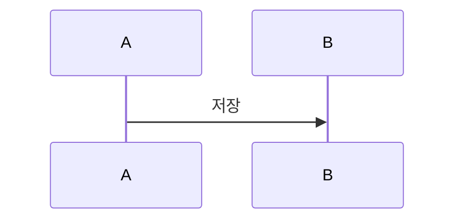

# F-NOTE-01 노트

## 개요

개요 설명.

## 요구사항

| ID | 요구 | 출처 |
|---|---|---|
| FR-NOTE-01-1 | 노트를 만든다 | NoteService.create |

## 정책

| ID | 규칙 | 강제 위치 |
|---|---|---|
| P-NOTE-01-1 | 없는 노트는 404 | NoteService.visible |

## 화면

화면 설명.

## 흐름

## 시퀀스

## 상태 전이

상태 전이 설명.

## 데이터

데이터 설명.

## 캐시·동시성

캐시·동시성 설명.

## API

API 설명.

## 테스트

테스트 설명.

## 변경 영향

변경 영향 설명.
